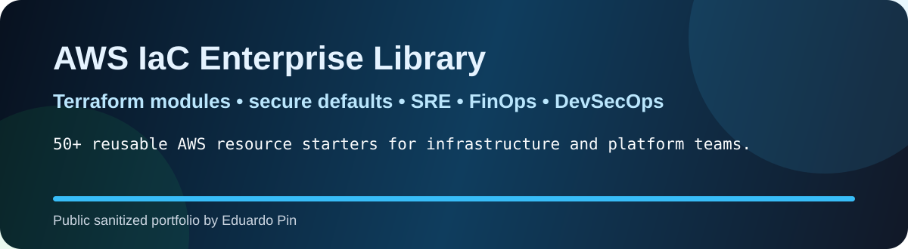

<div align="center">
  
  <h1>AWS IaC Enterprise Library</h1>
  <p>Reusable Terraform building blocks for AWS infrastructure, with consistent interfaces and reviewable examples.</p>
  <p>
    <a href="https://github.com/eduardopin/aws-iac-enterprise-library/actions/workflows/validate.yml"></a>
    <a href="https://eduardopin.github.io/aws-iac-enterprise-library/"></a>
    <a href="https://github.com/eduardopin/aws-iac-enterprise-library"></a>
  </p>
  <p><a href="https://eduardopin.github.io/aws-iac-enterprise-library/"><strong>Explore the module catalogue</strong></a></p>
</div>

This repository contains 58 small modules spanning networking, identity and
security, storage, messaging, compute, containers, databases, edge delivery,
observability and analytics. Every module has a same-named example and the
standard `main.tf`, `variables.tf`, `outputs.tf`, `versions.tf` and `README.md`
layout.

This repository contains public-safe examples and operational guidance for infrastructure, platform engineering, SRE, FinOps and DevSecOps review. It avoids proprietary customer details, credentials, internal hostnames and account-specific identifiers.

## Quick Usage

The VPC example uses the module's real `name` and `tags` interface. This source
pins the module to the reviewed repository revision:

```hcl
module "vpc" {
  source = "git::https://github.com/eduardopin/aws-iac-enterprise-library.git//modules/vpc?ref=4bc5a339b9bb4b5606c89e053b03593c92e5231b"
  name   = "example-vpc"

  tags = {
    Environment = "dev"
    Owner       = "platform"
    ManagedBy   = "terraform"
  }
}
```

Review provider versions, compliance requirements, account topology, IAM
boundaries, naming conventions and organization-specific guardrails before
production use.

## How to Review

Start with the architecture and operating model documents, then inspect the examples and validation workflow. The repository is organized so maintainers can evaluate purpose, safety boundaries, operational value and extension points without needing private environment context.

## Repository Map

- `docs/` - design notes, operational guidance and review material.
- `examples/` - runnable or adaptable examples with placeholder values.
- `scripts/` - local validation helpers and the site generators
  (`site_stats.py`, `render_site_assets.py`, `render_og.py` and
  `check_site_links.py`).
- `.github/workflows/` - continuous validation and repository hygiene checks.

## Confidentiality

All examples are intentionally generic. Replace placeholders with values from your own environment and review security, compliance and cost impact before use.

## Contributing / Help Wanted

Read [CONTRIBUTING.md](CONTRIBUTING.md) for the local validation flow and browse
the concrete [good first issue drafts](docs/community/GOOD_FIRST_ISSUES.md) for
small ways to improve examples, documentation and repository checks.
